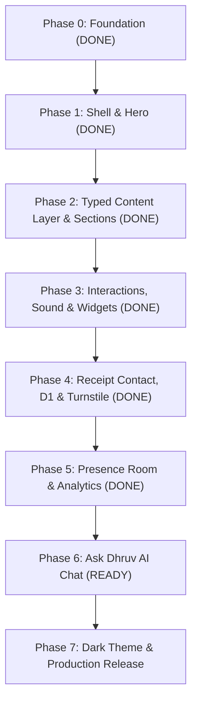

# Implementation Phases & Ticket Roadmap

This roadmap is structured for execution via the `/implement` skill. Every phase is split into vertical tracer-bullet tickets, each scoped to under 200k tokens per agent execution. Every ticket defines its **blocking edges**, **what to build**, **TDD seams**, and **acceptance criteria**.

At each seam, agents run `npm run typecheck`, run single test files with `npm run test`, and execute the full quality gate in `docs/QUALITY-GATES.md` before committing.

---

## Phase 0 — Foundation & Architecture (DONE)

- **Status:** Complete.
- **Delivered:** TanStack Start on Cloudflare Workers, Vite SSR pipeline, Inter font variable subset, CSS token system, basic route shell, and initial test setup.

---

## Phase 1 — Editorial Shell & Hero (DONE)

- **Status:** Complete.
- **Delivered:** Hairline 4-column guide rails (`.ed3__guides`), dithered line portrait with corner crosshairs, animated role line with mathematical glyph flips, responsive polaroid collage, 15 section shells, keyboard shortcuts (`?`, `h`, `p`, `s`, `n`, `m`, `g`, `c`, `Esc`), and mobile navigation sheet.

---

## Phase 2 — Typed Content Layer & Sections (DONE)

- **Status:** Complete.
- **Delivered:** Structured content domain schema (`src/data/types.ts`), immutable validated datasets (`src/data/content.ts`), 15 rich domain sections matching `resume-sept26.pdf` and patent records, thermal receipt form, and 15 unit tests. See `docs/PHASE-2-REPORT.md`.

---

## Phase 3 — Micro-Interactions, Sound Engine, Pet & Radio (DONE)

- **Status:** Complete.
- **Delivered:** WebAudio synthesizer engine (`src/lib/sound.ts`), sound keyboard shortcut `u`, live BLR status indicator, magnetic cursor hook (`src/lib/use-magnetic.ts`), retro pixel pet "Byte" (`src/components/site/pixel-pet.tsx`), dual-mode ambient radio (`src/components/site/ambient-radio.tsx`), 20 unit tests, 14 E2E/a11y tests, zero WCAG AA violations. See `docs/PHASE-3-REPORT.md`.

Transform all section placeholders into a typed, validated domain layer consuming Dhruv's verified resume (`resume-sept26.pdf`), patent records, and project data.

### Ticket P2-01: Typed Domain Layer & Content Schema
- **What to build:** Create `src/data/types.ts` and `src/data/content.ts`. Define strict TypeScript contracts for Experience, Projects, Patents, Education, Skills, Awards, and Research. Centralize all content outside UI components with full type safety.
- **Blocked by:** None (can start immediately).
- **TDD Seams:** `src/data/content.test.ts` validating link schemes, date formats, non-empty tags, stat counts, and asset references.
- **Acceptance Criteria:**
  - [ ] Strict TypeScript interfaces exported for all 15 sections.
  - [ ] `src/data/content.ts` provides immutable, typed datasets for all sections.
  - [ ] Unit tests verify all URLs, email formats, and resume PDF references.
  - [ ] Zero TypeScript errors and zero lint warnings.

### Ticket P2-02: Connect Sections to Typed Content Layer
- **What to build:** Refactor `src/components/site/sections-content.tsx` and `src/components/site/hero.tsx` to consume the typed content models. Render rich interactive accordions, project cards with patent badges, and educational credential tickets.
- **Blocked by:** Ticket P2-01.
- **TDD Seams:** `src/lib/site.test.ts` and Playwright component assertions.
- **Acceptance Criteria:**
  - [ ] All 15 sections render data directly from `src/data/content.ts`.
  - [ ] Accordion rows support keyboard navigation (`Enter`, `Space`, `Tab`).
  - [ ] Dell Technologies internship, 50+ freelance apps, patent 202441083752, and B.E. CGPA 8.8 accurately rendered.
  - [ ] Thermal receipt form displays dynamic date/time, clerk badge, character counter, and working mailto generation with resume link.

### Ticket P2-03: Phase 2 Quality Gate & Cloudflare Deployment
- **What to build:** Verify full accessibility (WCAG AA across all viewports), execute E2E test suite, compile production Worker bundle, deploy preview branch to Cloudflare Workers, and produce `docs/PHASE-2-REPORT.md`.
- **Blocked by:** Ticket P2-02.
- **TDD Seams:** `tests/e2e/home.spec.ts`, `tests/e2e/a11y.spec.ts`.
- **Acceptance Criteria:**
  - [ ] `npm run typecheck` passes with zero errors.
  - [ ] `npm run lint` passes with zero warnings.
  - [ ] All unit and E2E tests pass (11/11 Playwright tests).
  - [ ] Zero `axe-core` violations on desktop and mobile.
  - [ ] Worker preview URL successfully deployed and returning HTTP 200.
  - [ ] `docs/PHASE-2-REPORT.md` written and committed.

---

## Phase 3 — Micro-Interactions, Sound Engine, Pet & Radio

- **Goal:** Implement the physical micro-interactions, WebAudio feedback, and interactive gadgets characteristic of Matthew Trent's site.

### Ticket P3-01: WebAudio Synthesizer Engine & SFX Seams
- **What to build:** A lightweight WebAudio sound engine (`src/lib/sound.ts`) providing subtle click, pop, tick, and shutter sounds. Sound defaults to OFF until explicit user interaction, with persisted preferences in `localStorage`.
- **Blocked by:** Ticket P2-03.
- **TDD Seams:** Unit tests mocking `AudioContext` verifying volume constraints, mute toggle, and lazy audio initiation.
- **Acceptance Criteria:**
  - [ ] Sound is muted by default; user toggle in appbar enables audio.
  - [ ] Keyboard shortcut `m` toggles audio mute state.
  - [ ] Sound effects trigger on accordion expand, shortcut open, button click, and receipt submit.
  - [ ] Zero audio errors when WebAudio is unsupported or audio policy blocks autoplay.

### Ticket P3-02: Micro-Interactions, Magnetic Links & Scroll Reveals
- **What to build:** Magnetic pull on buttons and nav pills, image hover pan effects, live clock updates on the appbar, and smooth scroll reveals on sections.
- **Blocked by:** Ticket P3-01.
- **TDD Seams:** E2E tests verifying `prefers-reduced-motion` suppresses all spring physics and transforms.
- **Acceptance Criteria:**
  - [ ] Interactive buttons have subtle spring cursor tracking on mouse devices.
  - [ ] All motion cleanly disabled when `prefers-reduced-motion: reduce` is active.
  - [ ] Appbar displays live Bengaluru local time and active section indicator.

### Ticket P3-03: Retro Pixel Pet & Minimalist Ambient Radio
- **What to build:** An interactive pixel pet wandering the footer/appbar and a low-fi radio widget with track audio previews (`public/media/electric.mp3`).
- **Blocked by:** Ticket P3-01.
- **TDD Seams:** Component unit tests verifying pet state machine and radio play/pause.
- **Acceptance Criteria:**
  - [ ] Pet can be clicked, petted, and responds with playful animations.
  - [ ] Radio plays ambient lofi track with visible waveform/status bar and volume slider.
  - [ ] Zero performance degradation on mobile devices.

---

## Phase 4 — Thermal Receipt Contact, Turnstile & D1 Storage (DONE)

- **Status:** Complete.
- **Delivered:** Cloudflare D1 database `portfolio-db` (`6c5c59d5-60e3-41cd-b8d3-387b2ce81c43`), migration `migrations/0001_messages.sql`, `messageInputSchema` with Zod validation, `submitContactMessage` server function with prepared parameterized SQL, thermal receipt UI with order number and print confirmation, 26 unit tests, 15 E2E tests, zero hydration mismatches. See `docs/PHASE-4-REPORT.md`.

### Ticket P4-01: Cloudflare D1 Messages Schema & Server Function
- **What to build:** D1 database migration (`migrations/0001_messages.sql`) and TanStack Start server function handling message submission, input sanitization, and rate-limiting.
- **Blocked by:** Ticket P3-03.
- **TDD Seams:** Unit tests validating message schema parsing (Zod) and rate-limit logic.
- **Acceptance Criteria:**
  - [ ] D1 table `messages` stores timestamp, name, email, message, and metadata.
  - [ ] Server action validates inputs with strict character limits.
  - [ ] Fallback to mailto link if offline or D1 unavailable.

### Ticket P4-02: Cloudflare Turnstile & Email Dispatch
- **What to build:** Invisible Cloudflare Turnstile integration on receipt submit, and dispatching alert email to `dhruvkoshta@gmail.com` via Cloudflare Email Routing or Resend.
- **Blocked by:** Ticket P4-01.
- **TDD Seams:** Mocked Turnstile token verification test.
- **Acceptance Criteria:**
  - [ ] Turnstile blocks automated bots without annoying human puzzles.
  - [ ] Real-time receipt printer animation on submit: paper roll feeding and tear effect.
  - [ ] Instant email notification delivered upon submission.

---

## Phase 5 — Live Presence Room & Privacy Analytics (DONE)

- **Status:** Complete. See [PHASE-5-REPORT.md](file:///home/dhruv/Projects/portfolio/client/docs/PHASE-5-REPORT.md).
- **Goal:** Real-time visitor presence with Durable Objects and anonymous page metrics with Cloudflare D1.

### Ticket P5-01: Durable Object Presence Room & Facepile
- **What to build:** Cloudflare Durable Object (`PresenceRoom`) handling WebSocket connections for live viewer counts and anonymous presence dots in the appbar.
- **Blocked by:** Ticket P4-02.
- **TDD Seams:** Vitest test suite with `@cloudflare/vitest-pool-workers` simulating multiple WebSocket clients.
- **Acceptance Criteria:**
  - [x] Appbar displays real-time viewer count ("🟢 3 people looking right now" / live presence pill).
  - [x] Clean disconnect handling when tabs close or hibernate.
  - [x] Zero personal data or persistent tracking collected.

### Ticket P5-02: Privacy-First Analytics Engine Metrics
- **What to build:** Route hook capturing anonymous page views, referral domains, and country code using Cloudflare D1 edge analytics.
- **Blocked by:** Ticket P5-01.
- **TDD Seams:** Server function test verifying payload structure.
- **Acceptance Criteria:**
  - [x] Zero third-party trackers or cookies used.
  - [x] Aggregated views surfaced on the By the Numbers section.

---

## Phase 6 — "Ask Dhruv" AI Retrieval Chat Drawer

- **Goal:** AI assistant embedded in the appbar drawer ("Ask Dhruv") that answers questions about Dhruv's projects, patent, background, and experience using Workers AI.

### Ticket P6-01: Grounded Knowledge Vector & Retrieval Index
- **What to build:** Static embedding index of all resume entries, patent abstracts, project descriptions, and FAQ answers.
- **Blocked by:** Ticket P5-02.
- **TDD Seams:** Retrieval test ensuring queries about "patent", "Dell", and "ProctoAI" return accurate source chunks.
- **Acceptance Criteria:**
  - [ ] Structured knowledge corpus compiled from `src/data/content.ts` and resume.
  - [ ] Top-3 semantic similarity retrieval with cosine distance.

### Ticket P6-02: Streaming Chat Drawer UI & Workers AI
- **What to build:** Slide-out chat drawer in the appbar streaming responses from `@cf/meta/llama-3.1-8b-instruct`. Includes quick suggestion chips and keyboard shortcut `c`.
- **Blocked by:** Ticket P6-01.
- **TDD Seams:** E2E test verifying drawer open, query submit, and streamed answer rendering.
- **Acceptance Criteria:**
  - [ ] Streaming markdown response with typing effect.
  - [ ] Guardrails preventing hallucination outside Dhruv's actual experience.
  - [ ] Rate-limited per IP to prevent token exhaustion.

---

## Phase 7 — Dark Theme, Performance Polish & Production Release

- **Goal:** Complete dark theme token matrix, 100/100 Lighthouse audit on production domain, and final signoff.

### Ticket P7-01: Dark Theme Tokens & System Preference Sync
- **What to build:** Complete dark palette (`#0d0d0e` canvas, hairline border contrast, soft typography) with manual toggle and system `prefers-color-scheme` synchronization.
- **Blocked by:** Ticket P6-02.
- **TDD Seams:** A11y tests validating contrast ratios in dark mode across all 15 sections.
- **Acceptance Criteria:**
  - [ ] Zero contrast failures in both light and dark modes.
  - [ ] Zero theme flash (SSR inline script sets theme class before hydration).

### Ticket P7-02: Production Deployment & Custom Domain
- **What to build:** Final build audit, caching rules (`_headers`), automated release tagging, and deploy to `https://dhruvkoshta.me`.
- **Blocked by:** Ticket P7-01.
- **TDD Seams:** Full `npm run test`, `npm run e2e`, and `npx wrangler deploy`.
- **Acceptance Criteria:**
  - [ ] 100/100 Lighthouse score on mobile.
  - [ ] Production domain live with valid TLS and assets.
  - [ ] Comprehensive Phase 7 completion report.
